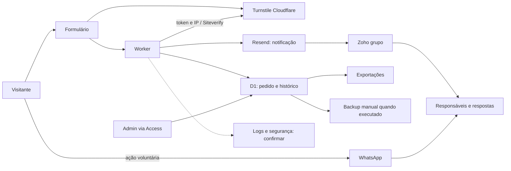

# Fluxos de dados pessoais

**Interno — preliminar, não publicar; consulta 25/11/2026. Responsável pelo tratamento e aprovação jurídica pendentes.** Factos observados são identificados; descrições de fornecedores são condicionadas à configuração contratada.

**Precedência:** a consolidação de 25/11/2026 no fim deste documento atualiza e substitui os pontos antigos que lhe sejam contrários. Dados de painel são comunicados pelo responsável, não verificados diretamente nesta intervenção.

O código valida campos, origem, Turnstile e duplicação; guarda antes do envio. D1 guarda dados, snapshots das casas, histórico e payload congelado. Resend recebe remetente, destinatário, Reply-To e corpo; confirmação da API não prova entrega. Zoho e respostas podem gerar cópias individuais; exportações, logs e backups não são eliminados pelo CRM. WhatsApp segue percurso próprio fora do formulário. Identificar todos os destinatários, dispositivos e cópias efetivos antes de fixar retenção.

## Distribuição e WhatsApp — evidência adicional

O responsável confirmou que o grupo geral tem três membros internos: cada notificação dá origem a três cópias nas caixas; eliminar numa caixa não elimina as restantes. Ausência de encaminhamento automático foi observada nas definições das três contas, não exclui outras regras ou cópias. Respostas usam endereços individuais. TLS enforced no Resend e entrega de teste real foram comunicados. Conteúdo do pedido, incluindo email de resposta e mensagem, é transmitido; a região irlandesa de envio não garante residência UE.

O código usa ligações `wa.me`, sem widgets, SDKs ou pixels Meta identificados na pesquisa do código público; isso não prova ausência de alterações injetadas por terceiros fora do código. Antes do clique não se envia mensagem ao WhatsApp através dessa ligação. Ao clicar, a ficha prepara texto com nome da casa; a página de contactos inclui motivo e, quando selecionadas, casas e ligações. Ao abrir/enviar, o serviço pode tratar número, mensagem e anexos enviados pelo utilizador; não se pressupõe envio automático. Instalação de Business, API ou integração CRM não foram confirmadas. Identificar pessoas autorizadas, retenção/conversas, backups, transferências e mecanismo de direitos. https://www.whatsapp.com/legal/privacy-policy-eea .
